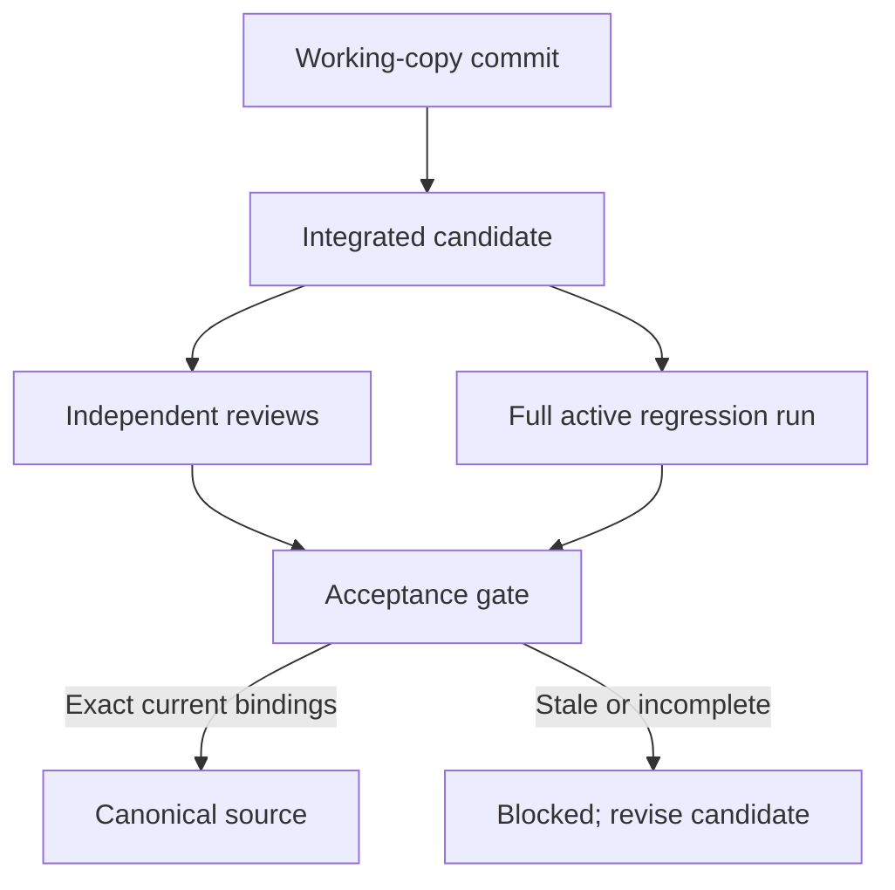

# Project-first architecture

A workspace owns configuration and projects. A project owns its source, agents, requirements, decisions, tasks, proposals, discussions and regression history. Agents are replaceable participants, not nested projects or owners of project memory.

## File layout

| Location | Purpose | Access |
| --- | --- | --- |
| `<workspace>/Files/Project-<project-id>_output/` | Canonical source | Principal reads; owner edits during initial baseline only |
| `<workspace>/.harnessyxor/projects/<project-id>/repository.git/` | Git objects, refs and indexes | Controller only |
| `<workspace>/.harnessyxor/projects/<project-id>/worktrees/<agent-id>/` | Developer/tester copy | Assigned writer through scoped tools |
| `<workspace>/.harnessyxor/projects/<project-id>/candidates/` | Integrated candidate checkouts | Controller and proposal-bound read tools |
| `<workspace>/.harnessyxor/projects/<project-id>/` | Controller identity, recovery journal, Git policy | Controller only |
| `<application-data>/harnessyxor.db` | Project/team records, conversations, permanent history | Controller only |
| `<application-data>/auth/accounts.db` | Password hashes and hashed sessions | Account service only |

Generic file tools reject `.git`, traversal, symbolic-link escapes and metadata paths. Worktrees separate edits; they are not an operating-system sandbox. Arbitrary candidate code requires a separate isolated executor.

## Team and history

Each project starts with a principal architect. Developer and tester agents change their own copies. QA and independent code/architecture reviewers inspect assigned candidates. Role labels do not grant write access. Reviewer identities must differ from the author and other required reviewers.

Agent retirement/replacement appends records rather than deleting contributions. Tasks retain their assigned agent, instructions and dependencies. The root view receives curated outcomes; teammate transcripts remain inspectable without becoming ordinary user conversation.

Global slots bound active agent execution segments, including model requests, native tools and approval waits. Architect delegation and dependency waits release slots. Direct controller verification requests do not acquire agent slots. Queued work can be cancelled. Startup marks interrupted execution without replaying commands.

Requirements and decisions have immutable versions. Pending proposals cannot replace the accepted design. Earlier rejected/superseded approaches stay available as warnings. The display feed is bounded; older project history remains stored.

The controller owns the versioned regression catalog. Model tools cannot activate a catalog or create observed passing receipts. Removing an active check requires a reason and retains its history.

Every actual user prompt to the principal advances the intent fence. This conservatively stales pending evidence even for a status question sent as a prompt. Browsing the progress UI does not. The fence identifies the guidance snapshot; it cannot prove that an agent understood every requirement.

## Acceptance

An immutable proposal binds the author branch, canonical base, integrated commit/tree, catalog revision/hash, requirements/intent revision, decision revision and policy revision. Reviews and receipts bind that same tuple. A changed base or context invalidates earlier evidence.

The executor runs one complete active suite against the candidate and checks its identity/cleanliness before and after. Acceptance cannot assemble a pass from selected results across failed runs. Missing command, manual or hardware execution remains pending.

Distinct independent code and architecture approvals are required. A comment does not clear a blocking review; the reviewer records a new verdict. Discussions, objections, closed proposals and linked replacements remain in history.

The final transaction checks current source/context and performs a Git compare-and-swap. A durable journal covers the Git/database boundary. Recovery fails closed on unresolved state and preserves edits. No model call or regression execution holds the final acceptance lock.

The initial baseline is an explicitly unverified bootstrap, not a shortcut for passing reviews or tests. Before the first Architect generation, bootstrap closes. Ordinary canonical edits and direct commits are then unavailable. Upload existing source before sending that first message.

## Evidence limits

Fixed native checks currently cover file existence/text/JSON and Git whitespace. Command tests require isolated candidate execution; physical/manual tests require operator evidence. Until supported evidence exists, these checks block acceptance.

A passing suite is only as strong as its tests and oracles. Version binding and independent review prevent stale or fabricated evidence; they do not guarantee complete coverage or mathematically correct code.
